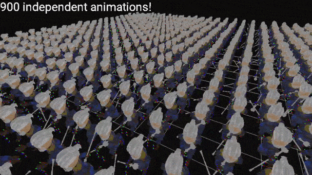
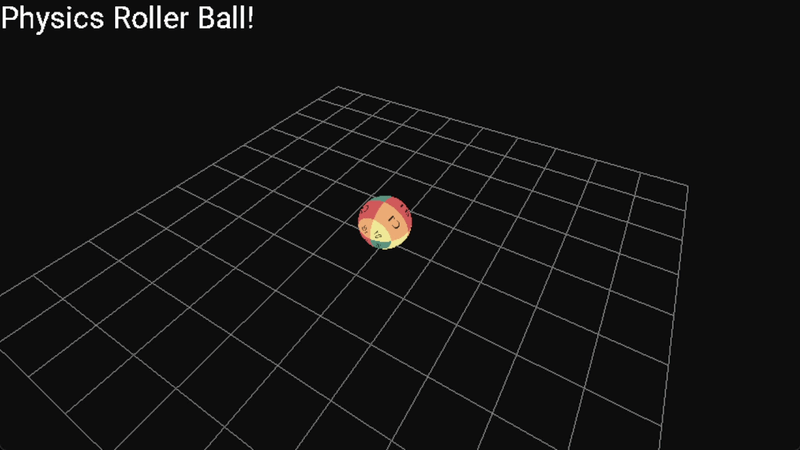

# Modulat C++17 3D Game Engine & Renderer

## Overview
This repository serves as a technical overview and architectural breakdown of a custom, multi-platform 3D game engine built from scratch using modern **C++17** and **OpenGL**. The engine was designed with a data-oriented mindset to maximize hardware efficiency, concurrency, and render throughput—powering a fully functional *Subway Surfers* style 3D endless runner.

>note: This repository currently serves as a documentation and project-overview landing page. The README describes the engine architecture and design foundations; it does not imply that the full source code, benchmarks, or test suite are present in this repository.
---

## Technical Highlights

* **Data-Oriented Entity Component System (ECS):** Custom-built ECS leveraging type-safe sparse sets, bitmask component filtering, and automatic $O(1)$ query caching for cache-friendly iteration.
* **Skeletal Animation System:** Highly optimized multithreaded pose evaluation running **900 independent skeletal mesh animations in <1ms** per frame while locked at **60 FPS**.
* **Modern Render Graph Pipeline:** Multi-pass rendering architecture utilizing `samplerBuffer` GPU texture buffers for matrix palette skinning, dynamic UI batching (FreeType atlas), and screen-space post-processing (FBOs).
* **Impulse-Based 3D Physics Engine:** Rigid body dynamics with sphere/plane colliders, impulse resolution, inertia tensors, and friction models, offloaded to a custom thread pool task graph.
* **Custom Asset Pipeline:** Asynchronous multi-threaded asset loader and custom Python exporter scripts for Blender (supporting binary/ASCII mesh, skeleton, and animation clip formats).

---

## Engine Architecture & Systems Design

### 1. Data-Oriented ECS & Memory Layout
To avoid pointer chasing and cache misses common in traditional object-oriented game engines, the engine uses a custom **Sparse Set ECS**:
* **Component Storage:** Sparse array for entity lookup; dense array contiguous in memory for cache-efficient iteration during system execution.
* **Bitmask Signatures:** Each entity is assigned a 64-bit component signature mask, allowing systems to instantly match required entities via bitwise operations.
* **Query Caching:** Entity queries generate cached views that update dynamically only when components are attached or detached.

### 2. High-Performance Skeletal Animation Pipeline

The animation engine evaluates complex bone hierarchies and blend trees efficiently across high entity counts:
1. **Parallel Animation Job System:** Animation clips, bone pose evaluations, and matrix interpolations (LERP/SLERP) are split across worker threads via a lock-free task queue.
2. **Matrix Palette Upload:** Local bone matrices are transformed into world space and packed into GPU-accessible buffer textures (`samplerBuffer`).
3. **Instanced Skinned Rendering:** A single vertex shader fetches bone transformation matrices using instance IDs and bone indices, minimizing CPU-to-GPU bandwidth and draw calls.

### 3. Render Graph Pipeline
The rendering subsystem uses an extensible **Render Graph** to manage render targets and execution passes dynamically:
* **Passes:** Geometry Pass -> Shadow Mapping Pass -> Post-Processing Pass (HDR / Bloom) -> UI / Text Rendering Pass.
* **UI Batching:** Text rendering utilizes FreeType to generate glyph atlases at startup, batching all UI quads into dynamic VBOs to achieve sub-millisecond UI draw times.

### 4. Custom Physics & Concurrency

* **Task-Graph Thread Pool:** Work-stealing/distributing thread pool architecture built on top of standard C++ atomics and condition variables for fine-grained task execution.
* **Physics Solver:** Fixed timestep integration featuring narrow-phase sphere-plane collision detection, contact constraint resolution, and linear/angular impulse application.

---

## Performance Benchmarks

| Metric | Measured Value | System Setup |
| :--- | :--- | :--- |
| **Animation Evaluation (900 entities)** | **< 0.85 ms / frame** | Multi-threaded Task Graph (4 Workers) |
| **Target Frame Rate** | **60 FPS (Locked)** | $1920 \times 1080$ Resolution |
| **ECS Query Overhead** | **$O(1)$** | Sparse set iteration |
| **Draw Call Overhead** | **< 8ms per frame** | GPU Instancing + Texture Buffers |

---

## Asset Pipeline & Exporters

* **Blender Exporter Tooling:** Custom Python scripts integrate into Blender's UI to export meshes, skeleton bone hierarchies, and keyframe animations into a lightweight custom binary format (`.mesh`, `.anim`, `skel` etc).
* **Asynchronous Loading:** Asset requests run off-thread with memory-mapped file loading, stream parsing, and automated GPU resource creation upon returning to the main render thread.
* **Asset Manager & Pipeline:** Centralized asset management engine using JSON registries to link raw asset files to internal shader uniforms and type bindings.

---

## Tech Stack & Dependencies
* **Core Language:** C++17
* **Graphics API:** OpenGL 4.5+ / GLSL
* **Windowing & Input:** GLFW, glad
* **Text Rendering:** FreeType
* **Tooling & Exporters:** Python 3, Blender API
